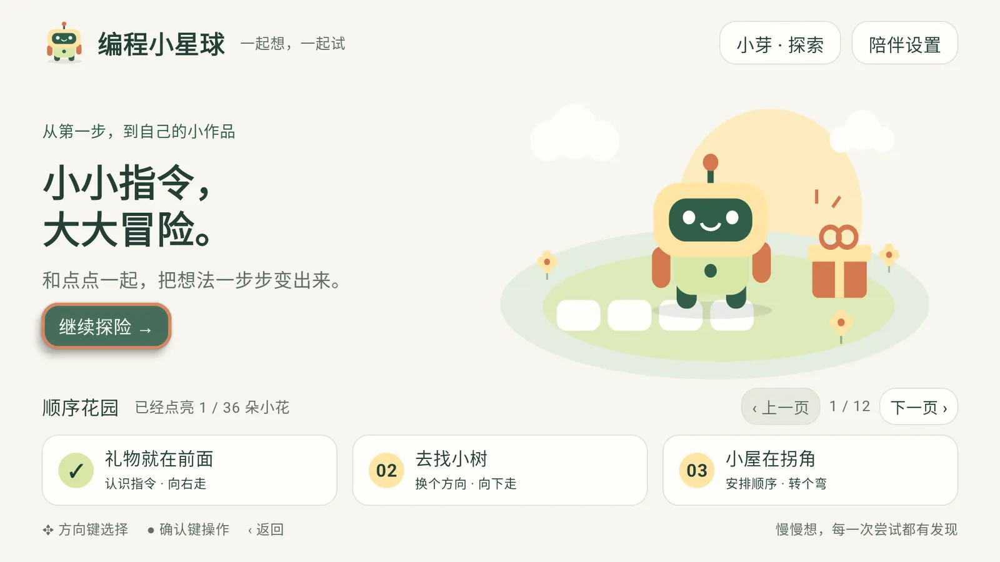

<p align="center">
  
</p>

<h1 align="center">CodeSpark (编程小星球)</h1>

<p align="center">
  A family coding app for Android TV: kids use the remote to line up cards for Dot the robot. 36 lessons go from sequences to loops, conditions, reusable helpers and map design.
</p>

<p align="center">
  <a href="https://codespark.vanjay.cn/">Website</a> ·
  <a href="https://github.com/wangwanjie/CodeSpark/releases/latest">Download</a> ·
  <a href="https://github.com/wangwanjie/CodeSpark/issues">Feedback</a> ·
  <a href="README.md">简体中文</a>
</p>



## Download

[CodeSpark.apk](https://github.com/wangwanjie/CodeSpark/releases/latest/download/CodeSpark.apk) is always the latest release (1.0.0, about 9.5 MB). Older versions are on the [Releases](https://github.com/wangwanjie/CodeSpark/releases) page.

## Requirements

- Android TV or a TV box on Android 6.0 (API 23) or later, in landscape.
- A regular remote: the D-pad moves focus, OK selects, Back opens the pause menu.
- ABIs: arm64-v8a, armeabi-v7a, x86, x86_64.
- 1.0.0 passed the full curriculum test on an Android TV API 34 emulator (1080p); it has not been checked on every TV brand.
- The interface and voice guidance are in Simplified Chinese.

## Install on a TV

CodeSpark is not in any app store, so install it by sideloading:

- **USB drive**: copy `CodeSpark.apk` to a FAT32/exFAT drive, open it with the TV's file manager, allow that file manager to install unknown apps when asked (often under Settings › Device Preferences › Security & restrictions › Unknown sources), then install.
- **Local network**: open a file-receiving app on the TV (many file managers and app stores have one), upload the APK from a phone or computer on the same Wi-Fi, then install it on the TV. If the TV is online, a downloader app can fetch `https://github.com/wangwanjie/CodeSpark/releases/latest/download/CodeSpark.apk` directly.
- **adb**: enable developer options (Settings › Device Preferences › About, press Build seven times), turn on USB or network debugging, then:

```bash
adb connect 192.168.1.50:5555
adb install -r CodeSpark.apk
adb shell am start -n cn.vanjay.codespark/.MainActivity
```

## What's inside

| Lessons | Theme | Practice |
| --- | --- | --- |
| 01–06 | Sequence Garden | Clear instructions, ordering steps, going around obstacles |
| 07–12 | Little Detective | Predicting the end, comparing programs, deleting/adding/replacing wrong steps |
| 13–18 | Repeat Playground | Repeating one move, repeating a chunk, combining loops |
| 19–24 | If Forest | Checking the current square, two cases, checks inside loops |
| 25–30 | Helper Workshop | Breaking tasks down, naming a helper, calling and combining it |
| 31–36 | My Creation Planet | Editing maps, checking they can be solved, saving and sharing |

Each lesson has an Explore and a Challenge setup (72 in total). Three profiles (Sprout, Star, Play together) keep separate progress, programs, helpers and six creation maps each.

## Privacy

The APK requests no network permission; lessons, voice and images are built in. No accounts, ads or analytics. Progress stays on the TV: updates signed with the same key keep it, uninstalling deletes it.

## Verify

Release builds are signed with APK Signature Scheme v1 + v2, certificate `CN=CodeSpark Family, OU=Personal, O=CodeSpark, C=CN`.

```text
Certificate SHA-256: f6bc73494d125b5e4ca0c13a2f9b93e126be339b4ca3c63c69a5f67c565d4fe0
1.0.0 APK SHA-256:   76090b55a15ff650334f3d7601d5d278cacbfa9115004d566cfe3dc9fd1524fc
```

## Feedback

Please open an [issue](https://github.com/wangwanjie/CodeSpark/issues).

© VanJay · [More apps](https://vanjay.cn)
