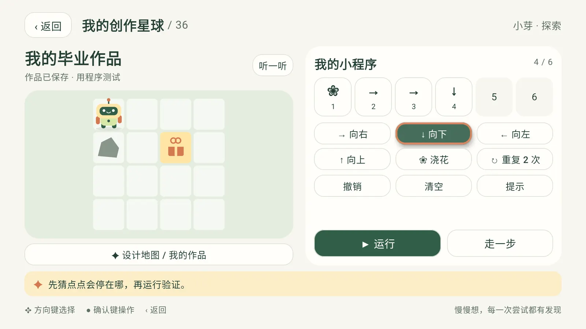
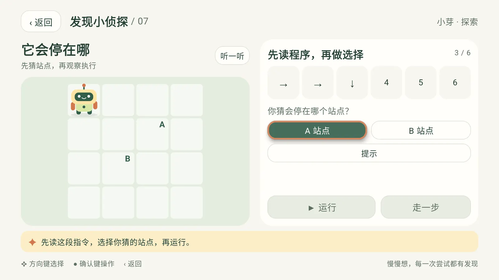
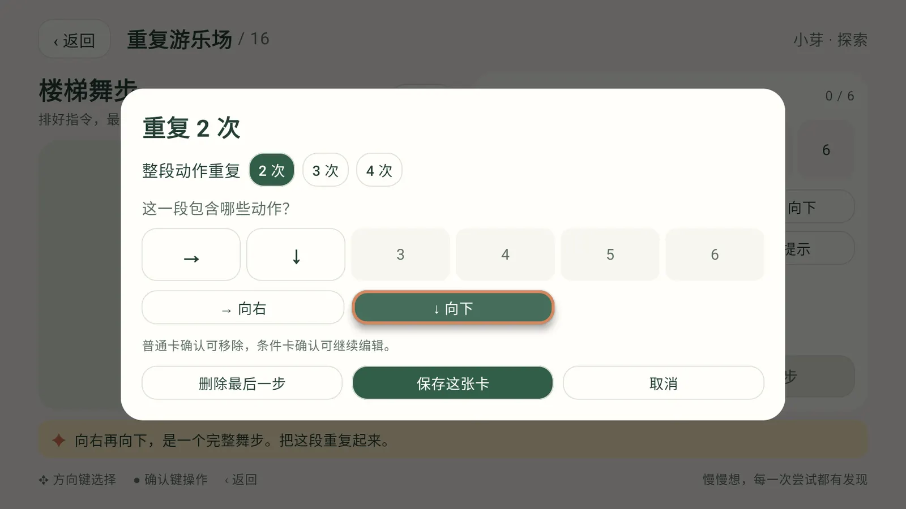
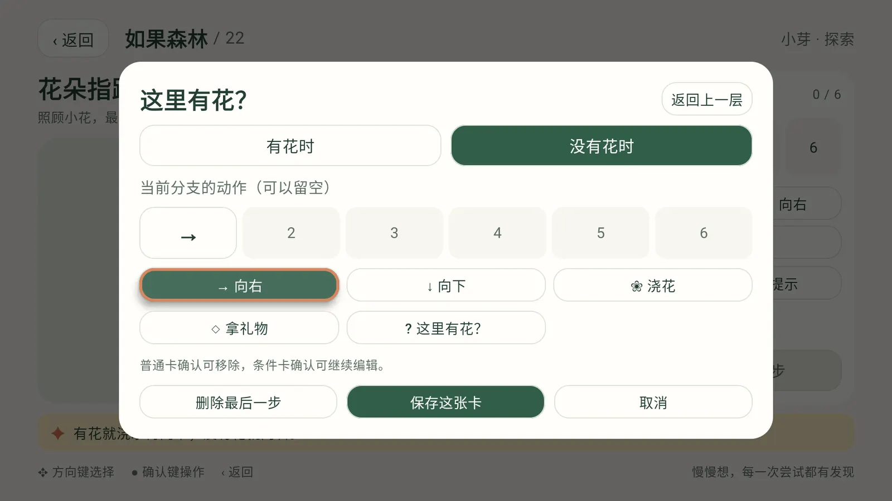
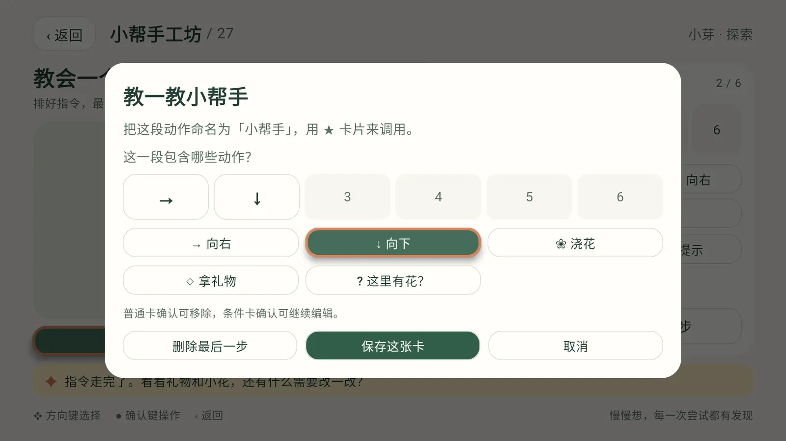
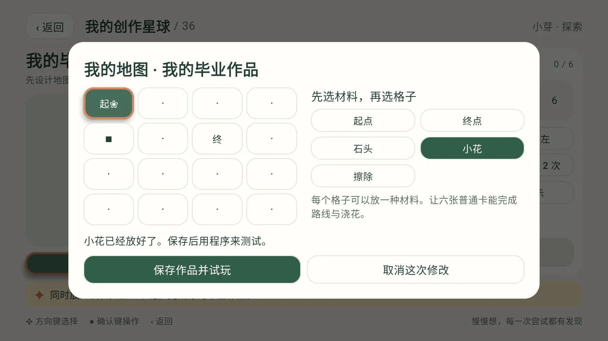

<p align="center">
  
</p>

<h1 align="center">编程小星球 · CodeSpark</h1>

<p align="center">
  面向家庭 Android TV 的亲子编程应用：孩子用遥控器给机器人点点排指令，36 个任务从顺序走到循环、条件、动作包和地图创作。
</p>

<p align="center">
  <a href="https://codespark.vanjay.cn/">主页</a> ·
  <a href="https://github.com/wangwanjie/CodeSpark/releases/latest">下载</a> ·
  <a href="https://github.com/wangwanjie/CodeSpark/issues">反馈</a> ·
  <a href="README.en.md">English</a>
</p>


## 下载

| 文件 | 说明 |
| --- | --- |
| [CodeSpark.apk](https://github.com/wangwanjie/CodeSpark/releases/latest/download/CodeSpark.apk) | 最新正式版，1.0.0，约 9.5 MB |

历史版本见 [Releases](https://github.com/wangwanjie/CodeSpark/releases)。

## 系统要求

- Android 6.0（API 23）及以上的 Android TV 或电视盒子，横屏使用。
- 普通遥控器即可：方向键移动焦点，确认键操作，返回键打开暂停菜单。
- 安装包包含 arm64-v8a、armeabi-v7a、x86、x86_64。
- 1.0.0 已在 Android TV API 34 模拟器（1080p）上完成完整课程测试，各品牌真机未逐一验证。
- 界面与语音为简体中文。

## 装到电视上

应用没有上架应用商店，需要侧载安装，任选一种方式：

**U 盘**

1. 在电脑上下载 `CodeSpark.apk`，复制到 U 盘（FAT32 或 exFAT）。
2. U 盘插到电视或电视盒子上，用自带的文件管理器打开这个 APK。
3. 第一次安装会提示「未知来源」，按提示为该文件管理器打开「允许安装未知应用」。常见位置：设置 › 设备偏好设置 › 安全性和限制 › 未知来源，各品牌名称略有不同。
4. 再次打开 APK 并安装，之后在应用列表里找到「编程小星球」。

**局域网传输**

电视上打开支持局域网接收文件的应用（不少电视的文件管理器或应用市场自带「手机传文件」功能），手机或电脑连同一个 Wi-Fi，打开它显示的网址上传 APK，再在电视上安装。电视能上网时，也可以用下载器类应用直接输入下载地址：

```text
https://github.com/wangwanjie/CodeSpark/releases/latest/download/CodeSpark.apk
```

**adb**

在电视的「设置 › 设备偏好设置 › 关于」连续按「版本号」七次打开开发者选项，再打开 USB 调试或网络调试。电脑装好 Android SDK Platform Tools 后执行（端口以电视显示为准，Android 11 及以上的无线调试可能需要先 `adb pair`）：

```bash
adb connect 192.168.1.50:5555
adb install -r CodeSpark.apk
adb shell am start -n cn.vanjay.codespark/.MainActivity
```

## 功能

| 任务 | 主题 | 孩子练习什么 |
| --- | --- | --- |
| 01–06 | 顺序花园 | 给出明确指令、安排先后、绕过障碍 |
| 07–12 | 发现小侦探 | 猜终点、比较程序、删除/补充/替换错误步骤 |
| 13–18 | 重复游乐场 | 同一动作重复、整段动作重复、组合循环 |
| 19–24 | 如果森林 | 看当前格子的条件、安排两种情况、循环里检查条件 |
| 25–30 | 小帮手工坊 | 拆解任务、命名动作包、重复调用和组合 |
| 31–36 | 我的创作星球 | 改地图、检查可解性、保存作品并邀请家人挑战 |

- 每个任务有「探索」和「挑战」两套配置，共 72 个；任务可直接选择、跨级和重玩。
- 三个档案：小芽（探索，建议 5 岁起步）、小星（挑战，建议 7 岁起步）、一起玩（合作），各自保存进度、程序、小帮手和六张创作地图。
- 出错时指出是第几张卡，可撤销、恢复原题；完成后引导孩子说一说自己的办法。
- 内置中文语音引导，可在陪伴设置里开关。

| | |
| --- | --- |
|  |  |
|  |  |
|  |  |

## 给家长

建议每次做两三个小任务：探索档案从 10–15 分钟起步，挑战档案约 15–20 分钟，按孩子状态随时收尾。本版提供时长建议，暂未加入自动时长限制和家长密码。

## 隐私

安装包没有申请网络权限，课程、语音和图片全部内置。没有账号、广告或统计。进度和作品只保存在电视本机：同签名覆盖升级会保留，卸载会一并删除。

## 校验与升级

正式版使用正式密钥签名（APK 签名 v1 + v2），证书主体 `CN=CodeSpark Family, OU=Personal, O=CodeSpark, C=CN`。

```text
证书 SHA-256：f6bc73494d125b5e4ca0c13a2f9b93e126be339b4ca3c63c69a5f67c565d4fe0
1.0.0 APK SHA-256：76090b55a15ff650334f3d7601d5d278cacbfa9115004d566cfe3dc9fd1524fc
```

后续版本使用同一密钥，直接覆盖安装即可保留进度。出现 `INSTALL_FAILED_UPDATE_INCOMPATIBLE` 说明设备上有另一个签名的同包名版本，需要先卸载它（会清除该版本的记录）。

## 反馈

问题和建议请提交到 [Issues](https://github.com/wangwanjie/CodeSpark/issues)。

© VanJay · [更多作品](https://vanjay.cn)
